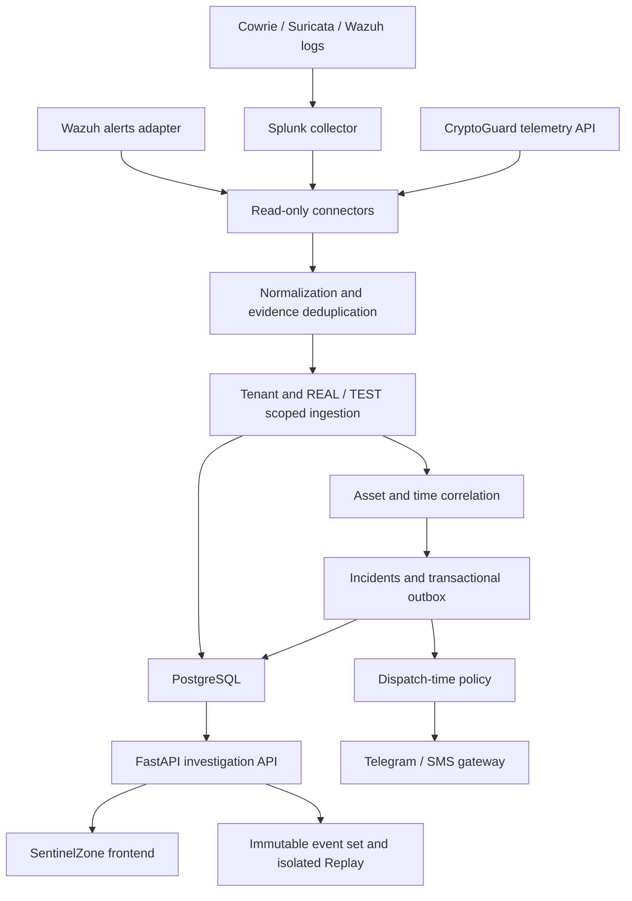

# SentinelZone SIEM Backend

This repository contains the SIEM Backend component of the SentinelZone SOC Platform. It provides the backend/API and correlation layer. It turns security observations into normalized events, explainable incidents, investigation evidence, and policy-controlled notifications.

**Release:** 0.28.1 · **Python:** 3.12 · **Database schema:** Alembic `0003`

This standalone developer handoff preserves the prepared v0.28.1 backend release, whose source lineage is v0.28.0. The existing architecture, business API, migrations, and tests are retained. Local validation is recorded in [Status](docs/STATUS.md); live infrastructure acceptance remains open.

[Quick start](docs/QUICKSTART.md) · [API](API.md) · [Architecture](ARCHITECTURE.md) · [Testing](TESTING.md) · [Known limitations](docs/KNOWN_LIMITATIONS.md) · [Release notes](docs/RELEASE_NOTES.md)

## What SentinelZone Backend Is

This service sits between security data providers and the SentinelZone frontend. It polls configured providers with read-only credentials, preserves the original sensor and collector provenance, persists tenant-scoped events, correlates evidence, and exposes authenticated investigation APIs.

The repository is **SentinelZone-SIEM-Backend**. All commands run from its root; extraction requires no restructuring. The separate [SentinelZone-SOC-Platform integration repository](https://github.com/Ulvu11/SentinelZone-SOC-Platform) coordinates the wider project. The frontend is developed separately.

### Backend responsibilities

Collect and normalize evidence, enforce tenant and role boundaries, correlate incidents, retain investigation history, expose stable API contracts, and apply notification policies. Sensor installation, frontend delivery, and automated response execution are outside this component.

## Architecture



`app/connectors/` polls Splunk, a Wazuh-compatible alerts adapter, and CryptoGuard. Cowrie and Suricata reach this backend through Splunk; they are normalizers, not additional direct polling connectors. Ingestion records evidence and runs correlation in the caller's transaction. Notifications use an outbox; optional scheduled tasks or CLI/systemd workers perform polling and dispatch.

Correlation uses asset identity, time proximity, original sensors, and optional session/port context. An IP match alone is insufficient. Replay evaluates snapshots in a separate temporary SQLite database; only snapshots and replay results are stored in the main database. See [ARCHITECTURE.md](ARCHITECTURE.md) for tenant and transaction boundaries.

## Major Features

- Normalization for Wazuh, Suricata, Cowrie, and CryptoGuard, with event time, receive time, original sensor, and collector provenance.
- Idempotent ingestion with merged external evidence references; separate REAL and TEST identities and correlation.
- Incident creation, explainable confidence/reason codes, lifecycle, optimistic `If-Match` updates, notes, timeline, and merge approval.
- Authenticated tenant isolation and viewer/analyst/operator/admin RBAC.
- Assets, agents, time-filtered alerts/overview/metrics, connector health, and per-sensor telemetry liveness.
- Deterministic JSON Case Pack, immutable event sets, versioned Replay, and inventory-based What Changed.
- Notification outbox, bounded retries, Telegram/SMS routing, dispatch-time suppression, legacy-notifier and canary policies.
- Allowlisted Splunk hunts and user/token administration.
- Action proposal creation, expiry, protected targets, and independent approval/rejection. **Approval records a decision; no SOAR executor is implemented.**
- Investigation exports and API aggregates. The `reports/` directory holds release validation evidence, not a scheduled business-reporting service.

## Tech Stack

| Component | Technology / role |
|---|---|
| Runtime | CPython 3.12; tested on Linux with 3.12.14 |
| API | FastAPI and Uvicorn |
| Validation/configuration | Pydantic and pydantic-settings |
| Persistence | SQLAlchemy 2.x; PostgreSQL with psycopg 3 |
| Schema history | Alembic; revisions `0001` → `0002` → `0003` |
| HTTP integrations | httpx with TLS verification and optional SOCKS support |
| Tests | pytest, FastAPI TestClient, HTTP mocks, SQLite regression databases |
| Deployment | Docker Compose, nginx and systemd templates |
| Dependencies | Exact versions in `requirements.lock.txt`; constrained direct requirements in `requirements.txt` |

## Repository Structure

Paths below are relative to the `SentinelZone-SIEM-Backend/` repository root.

| Path | Purpose |
|---|---|
| `.github/workflows/` | Root GitHub Actions workflow for isolated SQLite and disposable PostgreSQL acceptance |
| `app/` | API routes, auth, connectors, normalization, database access, incidents, notifications, and services |
| `contracts/` | Generated JSON Schemas for normalized events, incidents, and connector health |
| `deploy/` | nginx TLS/reverse-proxy configuration, management allowlist, systemd services/timers |
| `docs/` | Onboarding, configuration, integration, status, limitations, licensing inventory, and OpenAPI |
| `fixtures/` | Synthetic/redacted test payloads; never proof of live telemetry |
| `migrations/` | Alembic revisions and frozen historical schema snapshots |
| `reports/` | Measured test/acceptance results and source checksums |
| `scripts/` | Acceptance, contract export, source/staged secret scan, static validation, and release tooling |
| `tests/` | Preserved behavior, security-boundary, migration, connector, and API regression tests |

Root [PUSH_TO_GITHUB.md](PUSH_TO_GITHUB.md) covers publication to your own standalone repository. [RELEASE_MANIFEST.md](RELEASE_MANIFEST.md) records the release scope; `SHA256SUMS` verifies shipped source files. The workflow is already at the repository-root location GitHub discovers.

## Quick Start

Docker Compose is the primary deployment path. Install Docker with Compose v2, extract the ZIP, and open a terminal in `SentinelZone-SIEM-Backend/`.

### Docker deployment

```bash
cp .env.example .env
```

Generate a new database password in your password manager, or use `python -c "import secrets; print(secrets.token_hex(32))"` locally. Set it as `POSTGRES_PASSWORD` and replace the password placeholder in `DATABASE_URL`. The Compose hostname must be `postgres`. A hex password avoids URL-encoding ambiguity; otherwise URL-encode it in the URL. Do not paste generated values into issues or commits.

Keep `APP_ENV=production`, fixture/mock flags false, and Telegram/SMS disabled. Set `CORS_ORIGINS` to your actual frontend origin. Unconfigured connectors are permitted and remain visibly `not_configured`.

```bash
docker compose config --quiet
docker compose up -d --build
docker compose exec backend alembic current
docker compose exec backend python -m app.cli create-user soc-admin admin
curl --fail-with-body http://127.0.0.1:8003/health
```

The image runs `alembic upgrade head` before starting Uvicorn; no separate initial migration command is needed for Compose. The admin command shows a generated token once. Store it securely. Until an identity exists, protected endpoints deny access.

A first-run `/health` response can have HTTP 200, `database=healthy`, and `status=degraded` because connectors are not configured. This is expected and does not mean live telemetry has been verified. API documentation is at `http://127.0.0.1:8003/docs`.

Compose templates have been inspected statically; Docker build/start on your target host is **UNVERIFIED**. See [QUICKSTART.md](docs/QUICKSTART.md) for PowerShell, startup checks, and troubleshooting. Back up an existing database before starting a newer image, because startup applies migrations.

## Native Python Installation

Use CPython 3.12 and a PostgreSQL database for production. Run validation in a clean checkout before creating `.env`.

```bash
python3.12 -m venv .venv
. .venv/bin/activate
python -m pip install -r requirements.lock.txt
python -m pip check
python scripts/acceptance.py
cp .env.example .env
```

Configure `.env` as above, using your PostgreSQL server hostname instead of `postgres`. Restrict file permissions (`chmod 600 .env` on Linux), then:

```bash
python -c 'from app.config import get_settings; get_settings().validate_runtime(); print("configuration accepted")'
alembic upgrade head
alembic check
python -m app.cli create-user soc-admin admin
uvicorn app.main:app --host 127.0.0.1 --port 8003
```

On Windows use `py -3.12 -m venv .venv`, `.venv\Scripts\Activate.ps1`, and `Copy-Item .env.example .env`. The lock now conditions `uvloop` on compatible platforms; native Windows execution has not been measured. Use Docker/WSL2 for the POSIX HTTP acceptance runner. [INSTALL.md](INSTALL.md) includes an isolated SQLite development path.

## Environment Variables and Configuration

Settings come from environment variables and `.env`; environment variables take precedence. `.env.example` contains safe flags and placeholders only. Restart API/workers after changing configuration.

| Category | Important variables |
|---|---|
| Application | `APP_ENV`, `DEBUG`, `DEFAULT_TENANT_ID`, `ALLOW_FIXTURES`, `ENABLE_LEGACY_MOCK_ROUTES` |
| PostgreSQL | `DATABASE_URL`; Compose also reads `POSTGRES_DB`, `POSTGRES_USER`, `POSTGRES_PASSWORD` |
| Authentication | `AUTH_DB_ENABLED`, optional `AUTH_TOKENS` bootstrap identities |
| CORS/proxy | `CORS_ORIGINS`, `CORS_ALLOW_CREDENTIALS`, `FORWARDED_ALLOW_IPS` |
| Splunk | `SPLUNK_URL`, `SPLUNK_TOKEN`, `SPLUNK_CA_FILE`, `SPLUNK_INDEX` |
| Wazuh | `WAZUH_URL`, `WAZUH_USERNAME`, `WAZUH_PASSWORD`, `WAZUH_CA_FILE`, `WAZUH_ALERTS_PATH` |
| CryptoGuard | `CRYPTOGUARD_URL`, `CRYPTOGUARD_READ_KEY`, `CRYPTOGUARD_CA_FILE`, `CRYPTOGUARD_EVENTS_PATH` |
| Polling/telemetry | `INGEST_INTERVAL_SECONDS`, `INGEST_OVERLAP_SECONDS`, `MAX_INGEST_EVENTS`, `STALE_AFTER_MINUTES`, `SENSOR_EXPECTED_INTERVALS`, `SENSOR_OFFLINE_MULTIPLIER` |
| Telegram | `TELEGRAM_ENABLED`, `TELEGRAM_BOT_TOKEN`, `TELEGRAM_CHAT_ID` |
| SMS | `SMS_ENABLED`, `SMS_WEBHOOK_URL`, `SMS_WEBHOOK_TOKEN`, `SMS_TO` |
| Notification policies | `LEGACY_TELEGRAM_ACTIVE`, `TELEGRAM_CANARY_ENABLED`, `TELEGRAM_CANARY_HOSTS`, `NOTIFICATION_TENANT_ID`, `ALLOW_TEST_NOTIFICATIONS`, `TEST_TELEGRAM_CHAT_ID`, `DISPATCH_INTERVAL_SECONDS`, `NOTIFY_MAX_ATTEMPTS` |

[Configuration reference](docs/CONFIGURATION.md) explains defaults, correlation, connector limits, protected targets, and the distinction between code defaults and the production template.

## Authentication / RBAC

Protected `/v1/*` routes read `Authorization: Bearer <token>`. This release uses opaque bearer tokens, not an interactive password login or an OAuth/JWT issuer. Preferred DB-backed users store a SHA-256 token hash; raw tokens are shown only on creation/rotation. Admin routes can disable users, change roles, and rotate tokens. Static `AUTH_TOKENS` is an optional bootstrap mechanism; production requires random tokens of at least 32 characters.

```bash
python -m app.cli create-user soc-admin admin
```

Run the command after migrations. CLI users belong to `DEFAULT_TENANT_ID`; request tenant ownership comes from the verified identity, not a tenant header. `/health` and FastAPI documentation are public by default and should remain behind your management boundary.

| Role | Permissions |
|---|---|
| viewer | Read |
| analyst | Read, investigate, Replay |
| operator | Analyst permissions plus transition, merge, hunt, approve |
| admin | Operator permissions plus administration |

Missing/invalid credentials return 401; insufficient permission returns 403; another tenant's object returns 404. See [API.md](API.md) for filtering and concurrency requirements.

## API

The measured default contract has **36 paths and 40 HTTP operations**. [docs/openapi.json](docs/openapi.json) is exported from the real application; [API.md](API.md) explains semantics and [endpoint inventory](docs/API_ENDPOINTS.md) lists every operation.

| Endpoint family | Purpose |
|---|---|
| `/health` | Database/connector health; inspect body as well as HTTP status |
| `/v1/alerts`, `/v1/overview`, `/v1/metrics` | Normalized evidence, summaries, and filtered aggregates |
| `/v1/incidents` | Lifecycle, evidence, notes, timeline, merge, and Case Pack |
| `/v1/assets`, `/v1/agents` | Observed asset inventory, snapshots, What Changed |
| `/v1/telemetry-health`, `/v1/telemetry/heartbeat` | Sensor liveness and admin telemetry observations |
| `/v1/event-sets`, `/v1/replay`, `/v1/replay/rules` | Immutable evidence sets and versioned comparison |
| `/v1/hunts/{approved_query_id}/run` | Allowlisted Splunk hunts |
| `/v1/notifications`, `/v1/notifications/dispatch` | Outbox visibility and admin dispatch |
| `/v1/merge-requests`, `/v1/action-proposals` | Decision workflows |
| `/v1/admin` | Ingest trigger, users, roles, and token rotation |

CryptoGuard is an upstream connector; this backend does **not** expose a `/v1/cryptoguard/...` route. It also has no generic public raw-ingest or SOAR-execution endpoint. Default legacy `/api/*` mock routes are absent.

## PostgreSQL & Migrations

PostgreSQL with synchronous `postgresql+psycopg` is required in production; Compose uses PostgreSQL 16. SQLite is for local development, regression tests, and isolated replay evaluation.

```bash
alembic heads
alembic current
alembic upgrade head
alembic check
```

The verified source head is `0003`; all supplied migration files remain byte-for-byte unchanged. Back up and rehearse upgrades before changing a populated deployment. Revision `0003` backfills tenant/mode ownership and refuses historical incidents that mix REAL and TEST evidence. Downgrades remove investigation tables and reject identity collisions. See [DATABASE.md](DATABASE.md) and [PostgreSQL acceptance](POSTGRESQL_ACCEPTANCE.md).

## Testing

Use a clean checkout with no `.env` or real connector credentials. Install the lock, then:

```bash
python -m pip check
python scripts/acceptance.py
python -m pytest -q -ra
python scripts/export_contracts.py --check
python scripts/check_secrets.py
python scripts/validate_release.py
```

Acceptance runs the full pytest suite plus dependency, secret, static-release, contract, loopback HTTP, and populated migration checks. The current release measured **179 passed, 0 failed, 2 skipped**; evidence is in [docs/STATUS.md](docs/STATUS.md) and `reports/acceptance-summary.json`. The supplied baseline was reproduced: **172 passed, 0 failed, 2 skipped**. The seven release-tooling cases were already included in the prepared handoff. This standalone conversion preserves all 181 collected cases without modifying tests.

The two SQLite-run skips require real PostgreSQL advisory locks and `FOR UPDATE SKIP LOCKED`. They are not failures and do not count as verified PostgreSQL behavior. PostgreSQL acceptance requires a new empty disposable `*_test` database and explicit reset acknowledgement:

```bash
python scripts/acceptance.py --postgres --allow-test-db-reset
```

Set `TEST_DATABASE_URL` securely first. The suite drops application tables; never use deployment data. [TESTING.md](TESTING.md) documents setup and skip rules. CI includes isolated SQLite and PostgreSQL jobs without live connector credentials. No hosted GitHub Actions success is claimed.

## Incident Engine

Ingestion correlates tenant- and mode-scoped evidence by asset, time, original sensor, and optional session/port context. Incidents expose reasons and confidence, evidence, notes, and a timeline. The lifecycle supports NEW, INVESTIGATING, CONTAINED, RESOLVED, and an optional terminal CLOSED state with disposition. Versioned updates use `If-Match`; approved merges preserve evidence. Case Pack, Replay, and What Changed support investigation without executing response actions.

## Notification Engine

Notifications are committed through a transactional outbox. Policy routes high/critical incidents to Telegram and critical incidents to the configured SMS webhook; low/medium incidents remain visible in the dashboard. Enqueue and dispatch both enforce tenant, REAL/TEST, legacy-notifier, and canary controls. Dispatch retries are bounded, and delivery can repeat if a process crashes after sending but before committing. Keep both external channels disabled until a reviewed live canary.

## Production Deployment

Use [DEPLOYMENT.md](DEPLOYMENT.md) for Compose or the supplied systemd services/timers, and `deploy/nginx-sentinelzone.conf` for a TLS reverse proxy. Bind the application to loopback, apply management/VPN firewall restrictions, configure valid certificates and CORS origins, and trust only the actual proxy peer. Validate `nginx -t`, service permissions, database backup/restore, and the container on the target host.

Keep external delivery disabled until provider contracts and a deliberate canary are verified. Use either configured in-process scheduling or systemd timers intentionally. Provider delivery can repeat across a crash after send and before DB commit; the outbox does not promise exactly-once external delivery.

## Security

- Never commit `.env`, tokens, database files, dumps, or private keys. Scan both the source and staged Git index.
- The Docker image uses a non-root account; Compose drops capabilities and uses a read-only root filesystem.
- Production rejects fixtures/mock routes, debug, SQLite, malformed bootstrap tokens, incomplete configured integrations, and wildcard CORS with credentials.
- Upstream connectors verify TLS and should use least-privilege read-only credentials; mount private CA files read-only when needed.
- Tenant-scoped ORM access and composite database relationships enforce application isolation. This is not PostgreSQL row-level security.
- REAL/TEST are isolated; Replay cannot dispatch notifications or execute actions. Test Telegram delivery requires an explicit separate destination; test SMS is denied.

See [SECURITY.md](SECURITY.md) for disclosure and current security scope.

## Integrations

| Integration | Code support | Live acceptance |
|---|---|---|
| Splunk | IMPLEMENTED: read-only export and approved hunts | UNVERIFIED |
| Wazuh | PARTIAL: Manager auth/health plus configurable alerts-adapter contract | UNVERIFIED |
| CryptoGuard | IMPLEMENTED: read-only telemetry polling/normalization | UNVERIFIED |
| PostgreSQL | IMPLEMENTED: driver, migrations, advisory/row-lock paths | UNVERIFIED |
| Telegram | IMPLEMENTED: sender, retry, legacy/canary/test policies | UNVERIFIED |
| SMS | IMPLEMENTED: generic bearer-authenticated webhook provider | UNVERIFIED |

IMPLEMENTED describes source support. UNVERIFIED means the live gate was not executed, not that the integration is broken. See [INTEGRATION.md](docs/INTEGRATION.md) and [real connector acceptance](REAL_CONNECTOR_ACCEPTANCE.md).

### Splunk integration

Configure `SPLUNK_URL`, a read-only `SPLUNK_TOKEN`, `SPLUNK_INDEX`, and a trusted CA when required. The connector reads search-export results and preserves the original sensor separately from the collector path. Cowrie and Suricata normalization consume their JSON through Splunk. Hunts use approved query identifiers, not arbitrary user-supplied searches.

### Wazuh integration

Configure Manager authentication and health settings plus `WAZUH_ALERTS_PATH` for an actual compatible alerts provider. Manager connectivity alone does not establish alert retrieval. The current adapter contract may require deployment-specific indexer/adapter integration; live acceptance remains UNVERIFIED.

### CryptoGuard integration

Configure `CRYPTOGUARD_URL`, a read-only key, and the telemetry endpoint. Polling and normalization support the documented event identity, time, host/risk fields, and cursor shapes. Confirm the actual upstream contract before enabling ingestion. This is an upstream integration, not an extra backend endpoint family.

### Integration with SentinelZone frontend

Set the frontend API base URL to this service's trusted HTTPS address and allow the exact frontend origin in `CORS_ORIGINS`. Send the user's backend bearer token in `Authorization`; connector credentials stay server-side. Match the stored OpenAPI response envelopes, display degraded/incomplete telemetry and TEST mode clearly, and handle `If-Match` conflicts by reloading. End-to-end frontend acceptance remains UNVERIFIED. See [the integration guide](docs/INTEGRATION.md).

## Current Validation Status

| Check | Status |
|---|---|
| Supplied baseline suite | PASS: 172 passed, 0 failed, 2 PostgreSQL-only skips |
| Current release suite | PASS: 179 passed, 0 failed, 2 PostgreSQL-only skips |
| Final clean-extraction acceptance | See external release manifest, recorded after ZIP creation |
| Production configuration regressions | PASS locally |
| SQLite populated migration regression/schema parity | PASS locally |
| Runtime OpenAPI and stored contracts | PASS locally |
| PostgreSQL live acceptance | UNVERIFIED |
| Real Splunk/Wazuh/CryptoGuard and Telegram/SMS canaries | UNVERIFIED |
| Target-host Docker/nginx/systemd | UNVERIFIED |
| Hosted GitHub Actions | UNVERIFIED; workflow supplied |

## Known Limitations

Wazuh alert retrieval may need an adapter for your actual deployment. Shared provider configuration belongs to one configured tenant. Sensor cadence and inventory snapshots require real feeders. Replay supports the built-in versioned correlation rules; it is not an arbitrary uploaded-rule engine. Case Pack AI/MITRE/user fields can be empty. Action proposals do not execute changes. Load, retention, real PostgreSQL behavior, frontend mapping, and live delivery require acceptance in your environment.

[KNOWN_LIMITATIONS.md](docs/KNOWN_LIMITATIONS.md) is the current consolidated list. [FIX_REPORT.md](FIX_REPORT.md) is retained as the historical v0.28.0 audit record.

## Development / Contribution

Clone your `SentinelZone-SIEM-Backend` repository, create a branch, work from the repository root, install the lock, and run acceptance before creating deployment secrets. Add focused regression tests for behavior changes, keep published migrations immutable, regenerate contracts only when required, scan staged files, commit, push your branch, and open a Pull Request into `main`.

[CONTRIBUTING.md](CONTRIBUTING.md) describes branch naming, testing, migrations, commits, and review. [PUSH_TO_GITHUB.md](PUSH_TO_GITHUB.md) provides exact workflows for creating a new standalone repository and updating an existing one.

## Release Information

Version **0.28.1** is a standalone packaging update to the prepared developer handoff. Application source, API schemas, dependency pins, tests, and migration history are unchanged from that handoff. [Release notes](docs/RELEASE_NOTES.md), [changelog](CHANGELOG.md), and [manifest](RELEASE_MANIFEST.md) record scope and evidence. Verify the separate ZIP checksum, then the extracted root `SHA256SUMS` before running acceptance; tests refresh report files. The adjacent external manifest records testing of the exact final ZIP.

## Responsible Use

SentinelZone is a defensive cybersecurity and SOC engineering project for environments you own or are authorized to assess and monitor.

## License

No project license grant was present in the supplied package. This release preserves [LICENSE-TODO.md](LICENSE-TODO.md); ownership and licensing require owner confirmation. **A public repository without an explicit license does not automatically grant unrestricted reuse rights.** The owner must confirm rights and select a license before unrestricted redistribution/reuse.

Dependencies retain their own terms; see [THIRD_PARTY_NOTICES.md](THIRD_PARTY_NOTICES.md) and [dependency inventory](docs/DEPENDENCY_LICENSES.md). No dependency wheels or vendored dependency trees are bundled in this source ZIP.
